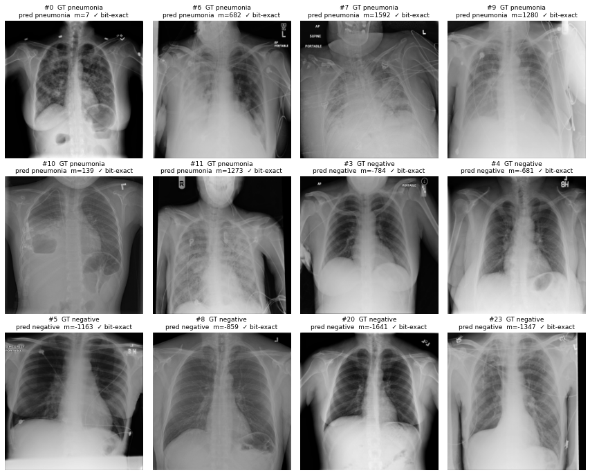

# Project FLASH

**An offline pneumonia screener built as a bit-exact neural network in FPGA hardware.**

FLASH takes a chest X-ray and says whether it shows signs of pneumonia. The
whole convolutional neural network runs as Verilog in the programmable logic
of a low-cost AMD Zynq-7020 (PYNQ-Z2 board), with no network connection and no
GPU. On the board, the chip reproduces an independent integer reference
model **bit for bit**.

> **Research prototype. Not a medical device.** It is not cleared or validated
> for clinical use and must not be used to diagnose, screen or treat anyone.

**Team FLASH** · BITS Pilani Hyderabad · Karthikeya Reddy (ML) · Yashwant Rajesh (Architecture) ·
5th place, AMD FPGA Hackathon 2026 (predecessor: [PneumoniaFPGA](https://github.com/Karthik-Flash/PneumoniaFPGA))

📄 **Full write-up: [`PROJECT_FLASH_REPORT.md`](PROJECT_FLASH_REPORT.md)** ·
board results: [`docs/V1_board_results_v1_2.md`](docs/V1_board_results_v1_2.md) ·
Vivado and PYNQ flow: [`docs/VIVADO_PYNQ_GUIDE.md`](docs/VIVADO_PYNQ_GUIDE.md) ·
hardware reports: [`docs/reports/README.md`](docs/reports/README.md) ·
docs index: [`docs/README.md`](docs/README.md) ·
paper: [`paper/`](paper/README.md)



*Live on the PYNQ-Z2 (2026-10-09): the first six true positives and first six
true negatives by index, each classified by the FPGA (12/12 bit-exact against
the golden model) and, for comparison, by the board's ARM core.*

## Status: V1 complete (V1.2.1, tag `v1.2.1-hw`)

Labels as in the [project brief](docs/Project_FLASH_brief.pdf). **Measured**
means a tool or board run on the current design; **Synthesis estimate** means
a Vivado estimate (every power figure is one); **Derived** means computed from
measured values; **Not yet done** means no number exists.

| What | Value | Label |
|---|---|---|
| Board output = golden model, 224×224, V1.2.1 | **244 / 244 images**: logit0, logit1, margin and decision all exact | Measured |
| Same, LED demo build | **244 / 244** | Measured |
| Time per image | **182.94 ms** compute (12,196,126 cycles), **184.73 ms** end to end | Measured |
| Clock, post-route timing | **66.67 MHz**; WNS +0.314 ns, WHS +0.030 ns, 0 failing endpoints | Measured |
| Chip usage | 7.3% LUT, 4.5% FF, 58.6% block RAM, 6.4% DSP | Measured |
| FPGA vs the board's ARM (same NumPy model) | 3.6–4.1× faster (ARM 665–744 ms) | Derived |
| Model quality, 4,003 unseen test patients | AUROC **0.8229** (95% CI 0.8083–0.8379); sensitivity 91.0% / specificity 53.9% at the chosen threshold | Measured |
| On the 244 verification images, computed by the board | sensitivity 0.959, specificity 0.467, AUROC 0.837 | Measured / Derived |
| Compute rate | 0.1333 GOP/s, 99.97% of the 1-MAC-per-clock peak (12,192,896 MACs in 12,196,126 cycles) | Derived |
| Chip power | 1.494 W, of which 1.256 W is the ARM side | Synthesis estimate |
| Energy per image | 273 mJ whole chip, 43.5 mJ programmable logic | Derived from the Synthesis estimate |

A board run on all 4,003 test images, measured board power and DICOM end to
end on the board are left to [V2](#v2-future-work).

**Headline results.**

- **Bit-exact on silicon.** The board reproduces the golden model on all 244
  verification images, on three bitstreams.
- **A board-only fault, found offline.** The first board run gave 0/244 while
  234/244 decisions still agreed. The cause was located offline with the
  golden model and 24 probe images. The PS's HP0 port bridge was in 64-bit
  mode while the design used 32 bits. It was confirmed on the board by
  flipping that one register bit (0/244 → 244/244). See report §10.
- **One engine, any resolution.** A single 3×3 convolution engine, driven by
  a layer table in on-chip memory, runs 28×28 and 224×224 with the same
  Verilog (next section).
- **Two measured weaknesses.** The model separates pneumonia from clearly
  normal lungs well (test AUROC 0.936) and from other lung findings much less
  well (0.738). The film type (AP or PA) alone scores 0.706, so part of its
  score is a shortcut. Report §5 and §9.4 show both with figures.

## How V1 scales to 224×224: the convolution layers and RTL

**Where v0 stopped.** The audited v0 accelerator was a fixed 28×28 design.
Each stage was a hand-written Verilog module (`line_buffer`, `mac_unit`,
`max_pool`, `fc_layer`, ...) with its sizes built in, stepped by a fixed
state machine. Its classifier flattened a 4×14×14 feature map into a 784→16
dense layer. Flatten plus the dense layers held 99.7% of its 12,634
parameters, and that count is tied to the resolution: at 224×224 the first
dense layer alone would need 802,816 weights.

**What V1 changed.**

| Change | What it buys |
|---|---|
| Five 3×3 convolutions, stride 2, padding 1, channels 1→8→16→32→48→64, instead of pooling | Each layer halves the map; no separate pooling stage (where one v0 bug lived) |
| Global average pooling before the classifier | The dense layer stays 64→2 at any resolution: 47,602 parameters, independent of image size |
| One reusable `conv_engine`, configured at run time by a 128-bit descriptor per layer (op, kernel, stride, pad, in/out channels, in/out height and width, shift, weight and bias base), held in a ROM and walked by `layer_seq` | Changing the network means regenerating a table; the Verilog stays the same |
| Two feature-map buffers, A and B, used ping-pong | Each layer reads one and writes the other |
| Padding as gated reads | An out-of-image tap reads as zero; no padded frame is stored |
| A 22-bit accumulator, sized from the real trained weights | Guaranteed not to overflow for any 8-bit input image |
| Shift and clamp to 0..255 as the ReLU | One shift per layer, no multiplier-based rescaling |
| GAP divides by 64 instead of 49, as a shift | No divider is needed, and training uses the same arithmetic |
| A threshold register (AXI-Lite) | The operating point changes without retraining |

**What 28×28 → 224×224 needed.** New `.mem` files (weights, biases, layer
table) and one RTL change: `fmap_ram` grew from 64 KB to 128 KB, because
conv1's output at 224×224 is 8×112×112 = 100,352 bytes.

**What it cost.**
- **Work:** 227,360 MACs per image become 12,192,896, ×53.6, derived from
  the two layer tables (the pixel count grows ×64).
- **Memory:** block RAM grew from 48.5 tiles to 80.5 for the core alone, in
  synthesis.
- **Clock:** the convolution's address arithmetic (a DSP multiply-add into
  the block-RAM address) became the critical path, so V1 runs at 66.67 MHz.

**The AXI wrapper.** `top_v1_axi` wraps the unchanged core for the Zynq. It
takes a 32-bit AXI-Stream carrying 4 pixels per beat, exposes AXI-Lite
registers (control, status, threshold, logits, margin, decision, version),
and has a cycle counter that gives the measured 12,196,126 cycles. The full
story is in report §6.5.

## Repository map

```
PROJECT_FLASH_REPORT.md   the V1 project report (start here)
README.md                 this page
paper/                    IEEE-format conference paper (flash_v1.tex, refs.bib, figures/)
colab/                    training + export notebooks (ProjectFlash_V1.ipynb is the source of truth)
v1/                       current design (V1.x)
  rtl/                    Verilog: conv_engine, layer_seq, fmap_ram, gap_unit, fc_unit, decision, top_v1, top_v1_axi
  sim/                    testbenches (tb_v1: 16/16 + 12/12 traces; tb_v1_axi: 33/33 checks)
  scripts/                Vivado flows: synth_top_v1.tcl, create_bd.tcl, build_hw.tcl, report_hw.tcl, export_bd.tcl, sim_tb_v1_axi.bat
  board/                  bitstreams (.bit/.hwh), board + demo notebooks and generators, bundle script, README
  mem/v1_1, mem/v1_2      exported weights, layer table, expected outputs, golden model, DICOM preprocessing
  constr/                 v1.xdc (legacy, top_v1-only project)
v0_baseline/              v0: audited 28x28 accelerator (244/244 in simulation), with its own README
docs/                     results, debug log, changelogs, reports, audits, raw board evidence, figures, archive
tools/                    report figures + derived numbers, PC timing of the golden model
verilog/                  local Vivado projects (gitignored except its README)
```

## Quick start on the board

1. Flash the official **PYNQ-Z2** image (tested with **PYNQ 3.1.1**) to an SD
   card. Set the boot jumper to SD and power from USB. Connect Ethernet to the
   PC and give the PC `192.168.2.1/24`.
2. On the PC, build the bundle:
   `powershell -ExecutionPolicy Bypass -File v1\board\make_board_bundle.ps1`.
3. Copy `board_bundle\` into `\\192.168.2.99\xilinx\jupyter_notebooks\flash_v1_2\`
   (user and password `xilinx`).
4. Open <http://192.168.2.99:9090> (password `xilinx`), then run
   `flash_v1_2/flash_v1_2_board.ipynb`. On a fresh boot, expect `AFI ... OK`
   and `BOARD: 244/244 bit-exact`. For the live demo with the board LEDs, run
   `flash_v1_2_demo.ipynb`.

Details, lab order and troubleshooting: [`v1/board/README.md`](v1/board/README.md).
Rebuilding the hardware and resuming the project: report §14–15 and
[`verilog/README.md`](verilog/README.md).

## How correctness is established

Three bit-exact links, then the board:

1. **Trained network = golden model** (identical logits on all 4,003 test
   images).
2. **Golden model = RTL** (xsim, every layer).
3. **RTL = board** (all 244 verification images).

The 244 images are a seeded, balanced slice of the test set, chosen without
looking at the model's confidence. The model misclassifies 70 of them, and
the hardware has to reproduce these errors as well; an exact match of 32-bit
scores on such images is very unlikely by chance. Every derived number in the report is recomputed
from the repository by `tools/make_report_figures.py`.

## V2 future work

The project pauses after V1. Three items would move the remaining
software-based results onto the board:

- **Board run on all 4,003 test images.** The 4,003-image accuracy is the
  golden model's, which is bit-exact to the board on 244; a full board run
  would make it literally the board's output.
- **Measured board power.** Power so far is only a Vivado estimate.
- **DICOM end to end on the board.** DICOM preprocessing has only been
  verified on the PC.

After those: a clinical operating point with better specificity, parallel
MACs, and a pipelined address path for 75 MHz or more (report §13).

## Data and licence

The radiographs and labels are the de-identified RSNA Pneumonia Detection
Challenge data
([RSNA](https://www.rsna.org/rsnai/ai-image-challenge/rsna-pneumonia-detection-challenge-2018);
Shih et al., *Radiology: Artificial Intelligence* 1(1), e180041, 2019),
drawn from the [NIH Chest X-ray Dataset](https://nihcc.app.box.com/v/ChestXray-NIHCC)
(Wang et al., ChestX-ray8, IEEE CVPR 2017, pp. 3462–3471). The NIH Clinical
Center is the data provider. RSNA's terms allow research use, forbid any
attempt to identify or contact the subjects, and require this attribution
wherever the data is shared, including the radiographs shown on this page.
