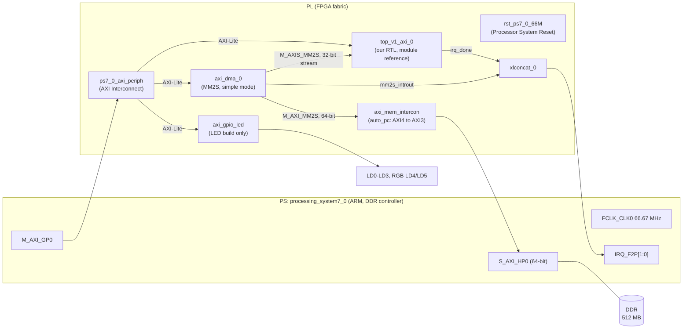

# Project FLASH: the Vivado and PYNQ flow, from RTL to a running board

This guide explains how the FLASH accelerator gets from Verilog files to a
bitstream that classifies chest X-rays on the PYNQ-Z2. It assumes you have
loaded a bitstream and programmed a device before, and nothing more. Every
step is the one used for the verified V1.2.1 build (`flash_hp64`).

Tools used: Vivado 2022.2 on Windows, the PYNQ-Z2 board files, a PYNQ 3.1.1
SD card image, and a web browser. The design fits the free Vivado edition,
which supports the xc7z020.

Menu names are from Vivado 2022.2. Other versions move a few items, but the
concepts are the same. Where this guide and `v1/scripts/create_bd.tcl`
disagree, the script is the reference, because the script is what built the
verified bitstream.

---

## 1. The big picture: one chip, two halves

The PYNQ-Z2 carries a Zynq-7020 (part `xc7z020clg400-1`). A Zynq is two
things on one die.

| Half | What it is | What FLASH uses it for |
|---|---|---|
| **PS** (processing system) | A fixed, hard-wired dual-core ARM Cortex-A9 computer with a DDR memory controller, USB, Ethernet, SD card, UART and timers. It exists in silicon whether or not you program the FPGA. | Runs Linux and Jupyter from the SD card. Loads the bitstream, reads image files, puts pixels in DDR, writes the threshold, starts the DMA, reads the results, draws figures, writes the LED register. |
| **PL** (programmable logic) | The FPGA fabric: LUTs, flip-flops, block RAM and DSP slices. It does nothing until a bitstream configures it. | All of the inference (12.2 million multiply-accumulates per image), plus the AXI DMA that moves pixels in, the AXI interconnects, and in the demo build the LED GPIO. |

The two halves talk over **AXI** buses that cross the PS/PL boundary at fixed
ports:

| Port | Direction | Used for in FLASH |
|---|---|---|
| `M_AXI_GP0` | PS is master, PL is slave | Register reads and writes from Python: the accelerator's registers, the DMA's control registers, the LED GPIO. |
| `S_AXI_HP0` | PL is master, PS (DDR) is slave | The DMA reads the image out of DDR through this high-performance port. |
| `FCLK_CLK0` | PS to PL | The 66.67 MHz clock for everything in the PL. |
| `FCLK_RESET0_N` | PS to PL | The reset that the reset block turns into clean resets for the PL. |
| `IRQ_F2P` | PL to PS | Interrupt lines. Wired up, but the notebook polls registers instead. |

### What "PS7" means

In Vivado the PS appears as one IP block called **ZYNQ7 Processing System**,
instance name `processing_system7_0`. People call it "PS7" because it is the
processing system of the Zynq-7000 family.

Adding this block does not create a processor; the processor is already in
the silicon. The block is a configuration panel. Its settings decide:

- how the DDR controller is set up (the PYNQ-Z2 board preset fills this in);
- which PS peripherals are routed to which pins (Ethernet, USB, SD, UART);
- which PS-to-PL ports exist (GP0, HP0) and how wide they are;
- the frequencies of the fabric clocks (FCLK_CLK0 to FCLK_CLK3);
- whether PL interrupts reach the ARM.

Vivado writes these settings into the hardware handoff file (`.hwh`) and into
an initialisation routine (`ps7_init`). **PYNQ does not run your design's
`ps7_init`.** It boots the PS with its own settings and, when you load an
overlay, only re-applies the fabric clocks from the `.hwh`. That detail caused
the one board-only bug in this project (Section 10).

### The FLASH block design



The data path for one image:

1. Python copies 50,176 pixel bytes into a DDR buffer.
2. Python writes THRESHOLD and CTRL over GP0.
3. Python starts the DMA over GP0.
4. The DMA reads DDR through HP0 and sends the bytes into `top_v1_axi` as a
   32-bit AXI-Stream, four pixels per beat.
5. The accelerator computes the network.
6. Python polls STATUS over GP0, then reads the logits, margin, decision and
   cycle count.

---

## 2. The files and what each one is for

| File type | Example in this repo | What it is | When it is used |
|---|---|---|---|
| Verilog design source `.v` | `v1/rtl/conv_engine.v` | Hardware description | Synthesis and simulation |
| Verilog header `.vh` | `v1/mem/v1_2/flash_v1_2/layer_table.vh` | `` `define`` macros: bit positions of fields in a layer descriptor, op codes | Compile time, synthesis and simulation |
| Memory init file `.mem` | `weights.mem`, `bias.mem`, `layer_table.mem` | Hex values, one per line, loaded by `$readmemh` | **Read once during synthesis** and frozen into block RAM contents inside the bitstream. Also read by simulation. |
| Testbench `.v` | `v1/sim/tb_v1.v`, `v1/sim/tb_v1_axi.v` | Drives inputs and checks outputs | Simulation only. Never synthesised, never on the board. |
| Test vectors `.mem` | `vectors/img_k.mem`, `exp_*.mem` | Input images and expected outputs from the golden model | Simulation, and the board notebook |
| Constraints `.xdc` | `v1/constr/v1.xdc` (disabled) | Pin locations and timing constraints | Implementation. The block design flow needs no hand-written XDC (Section 6.8). |
| Block design `.bd` | `flash_bd.bd` (inside the project folder) | The diagram of IP blocks and wires | Generated into HDL; recreated from `v1/scripts/create_bd.tcl` |
| HDL wrapper | `flash_bd_wrapper.v` | Generated Verilog top that instantiates the block design | The synthesis top |
| Checkpoint `.dcp` | `*.runs/impl_1/*.dcp` | Saved netlist at a stage of the flow | Large and binary; not committed |
| Bitstream `.bit` | `v1/board/flash_hp64.bit` | The PL configuration | Loaded onto the board |
| Hardware handoff `.hwh` | `v1/board/flash_hp64.hwh` | XML description of the block design: IP names, addresses, PS settings | Read by PYNQ next to the `.bit` |
| Hardware export `.xsa` | `flash_bd_wrapper.xsa` | Zip with the bitstream and handoff, for Vitis | Optional; not needed for PYNQ |

**Why weights are not on the board as files.** `top_v1.v` loads the weights,
biases and layer table with `$readmemh`. The file names are parameters. In
the block design they come from `top_v1_axi.v`, whose defaults are absolute
paths (`C:/KarDRIVE/Projects/ProjectFlash/v1/mem/v1_2/flash_v1_2/*.mem`);
the relative defaults inside `top_v1.v` (`../mem/v1_2/...`) are only for the
bare-core testbench. Synthesis reads the files and stores the values as block
RAM initial contents. After that, the bitstream is
self-contained. Changing a weight means re-running synthesis. Always check the
synthesis log for

```
INFO: [Synth 8-3876] $readmem data file '...weights.mem' is read successfully
```

and make sure there is no `Synth 8-4445` ("could not open"). A missing file
gives zeros in the RAM and a bitstream that builds without complaint. Early in
V1.2 a build silently loaded the 28×28 weights, because the default paths in
`top_v1.v` pointed at the wrong stage and only the testbench overrode them.

---

## 3. Before you start

1. **Install Vivado 2022.2** (the free edition is enough for the xc7z020).
2. **Install the PYNQ-Z2 board files.** Copy the `pynq-z2` folder from TUL's
   board files into `C:\Xilinx\Vivado\2022.2\data\boards\board_files\`. After
   restarting Vivado, the board appears as `tul.com.tw:pynq-z2:part0:1.0`. The
   board files give you the DDR settings, the PS preset and named interfaces
   such as `leds_4bits`.
3. **Clone the repository.** All paths below are relative to its root. The
   build expects the repo at `C:\KarDRIVE\Projects\ProjectFlash`: the
   `.mem` paths in `top_v1_axi.v` (`WEIGHTS_FILE`, `BIAS_FILE`,
   `LAYER_TABLE_FILE`) and the vector path `VEC` in `v1/sim/tb_v1_axi.v` are
   absolute. Clone there, or edit those parameters before you build.
4. **Never let two Vivado sessions touch one project.** If the GUI has a
   project open, a batch script writing the same project will have its
   changes overwritten by the GUI. Close the project first.

---

## 4. Create the project and add the sources

1. **File → Project → New**, then Next.
2. Name the project (the verified one is `ProjectFlashV1_hw` in
   `verilog/ProjectFlashV1_hw/`). Choose **RTL Project**. You can tick "Do not
   specify sources at this time".
3. On **Default Part**, open the **Boards** tab, search `pynq`, and select the
   PYNQ-Z2. This sets the part to `xc7z020clg400-1` and makes the board preset
   available. Finish.

### 4.1 Design sources

1. Flow Navigator → **Add Sources** → "Add or create design sources".
2. Add `v1/rtl/top_v1.v`, `layer_seq.v`, `conv_engine.v`, `fmap_ram.v`,
   `gap_unit.v`, `fc_unit.v`, `decision.v` and `top_v1_axi.v`.
3. **Untick "Copy sources into project".** The project then references the
   repo files, so editing a file in VS Code is the same as editing it in
   Vivado, and git tracks it.
4. Add `v1/mem/v1_2/flash_v1_2/layer_table.vh` the same way.

### 4.2 Make the header a Global Include

`top_v1.v` uses the `LT_*` macros without its own `` `include``. Vivado will
not add the accelerator to a block design until the header is a project file
marked as a global include (otherwise you get `[filemgmt 56-591] ... needs to
be added to the project`).

- In the Sources window, select `layer_table.vh` and tick **Global Include**
  in Source File Properties (or right-click → Set Global Include).
- Tcl equivalent:
  `set_property is_global_include true [get_files layer_table.vh]`
- `build_hw.tcl` also sets the file type to Verilog Header and adds the
  header folder to the include directories of `sources_1` and `sim_1`:
  `set_property include_dirs [list <repo>/v1/mem/v1_2/flash_v1_2] [get_filesets sources_1]`
  (Settings → General → Verilog options in the GUI).

It then appears under Design Sources → Global Include. It also shows under
`sim_1`, because simulation sources inherit the design sources.

### 4.3 The Libraries tab

All of these files compile into the default library `xil_defaultlib`. The
Libraries tab of the Sources window just shows that grouping. You do not need
to change it.

---

## 5. Simulate before you build hardware

Simulation is where the arithmetic is proven exact. Hardware is only built
after the simulation passes.

### 5.1 Add the testbenches

1. **Add Sources** → "Add or create simulation sources". Add
   `v1/sim/tb_v1.v` and `v1/sim/tb_v1_axi.v`, again without copying.
2. They go into the `sim_1` fileset (Simulation Sources). They are never part
   of synthesis.
3. Right-click `tb_v1_axi` → **Set as Top** for the wrapper test.

The two testbenches check different things:

| Testbench | Device under test | What it proves |
|---|---|---|
| `tb_v1` | `top_v1`, the bare accelerator | Logits, margin and decision exact on 16 images at 224×224, plus 12 per-layer traces against the golden model |
| `tb_v1_axi` | `top_v1_axi`, the AXI wrapper around `top_v1` | 33 checks over three runs (images 0 and 1, then image 0 with THRESHOLD = 0x7FFFFFFF): logits, margin and decision against the golden model; AXI-Lite writes with address first, data first and both together; `tvalid` gaps from an LFSR; VERSION; the THRESHOLD reset value; STATUS.done and STATUS.err behaviour, early `tlast` and soft reset. CYCLES is checked to be nonzero and printed (12,196,126 for every run). |

### 5.2 Run it

- Flow Navigator → **Run Simulation → Run Behavioral Simulation**. Vivado
  compiles with `xvlog`, elaborates with `xelab` and opens the `xsim` viewer.
- In the Tcl Console type `run all` if it stops at the default time limit.
- A full image at 224×224 is 12.2 million cycles, so a run takes minutes.
- Read the console. `tb_v1_axi` ends with `checks: 33, failures: 0` and
  `RESULT: PASS`.
- Scripted alternative: `v1\scripts\sim_tb_v1_axi.bat`. It simulates three
  full images; the result is at the end of `verilog\sim_tb_v1_axi\xsim.log`.

**The relative-path trap.** xsim runs inside
`<project>.sim/sim_1/behav/xsim/`. A testbench that opens `../mem/...` will
look relative to that folder and find nothing. `tb_v1_axi` uses absolute
paths and works anywhere; `tb_v1` uses relative ones and needs its files next
to the run folder.

**What simulation cannot see.** The testbenches drive the AXI-Stream and
AXI-Lite ports directly. There is no PS, no DDR and no HP0 port in the
simulation. Section 10 shows the bug that hid in exactly that gap.

### 5.3 Why you cannot implement `top_v1` on its own

The legacy project `verilog/ProjectFlashV1` used the bare `top_v1` as its top.
Its logits, margin and status become 98 top-level I/O ports, and placement
fails with `[Place 30-58] IO placement is infeasible. Number of unplaced IO
Ports (98) is greater than number of available sites (75).` A bare core is not a board design. It needs the PS, a way to get
data in (the DMA) and a way to read results (registers). That is what the
wrapper and the block design provide.

---

## 6. Build the block design

1. Flow Navigator → IP INTEGRATOR → **Create Block Design**. Name it
   `flash_bd`.

### 6.1 Add and configure the PS7

1. Click **+** (Add IP), search "ZYNQ7", add **ZYNQ7 Processing System**.
2. Click **Run Block Automation** in the green banner. Keep "Apply Board
   Preset" ticked. This sets up DDR and the fixed PS pins and makes the `DDR`
   and `FIXED_IO` external ports.
3. Double-click the block to customise it:
   - **PS-PL Configuration → HP Slave AXI Interface:** enable `S AXI HP0` and
     set its data width to **64**. (V1.2 used 32 and failed on the board;
     see Section 10.)
   - **PS-PL Configuration → GP Master AXI Interface:** `M AXI GP0` stays
     enabled.
   - **Clock Configuration → PL Fabric Clocks:** `FCLK_CLK0` requested
     frequency **66.666672** MHz. The PS divides its 1000 MHz IO PLL by an
     integer, so only certain frequencies exist: asking for 75 MHz gives
     76.92 MHz, and the next step down is 71.43 MHz. Enter the exact
     achievable value so that PYNQ, which recomputes the divider from the
     `.hwh`, programs the same clock.
   - **Interrupts → Fabric Interrupts → PL-PS Interrupt Ports:** enable
     `IRQ_F2P`.

Tcl equivalents, for reading `create_bd.tcl` (the values the script ends
with):

```tcl
set_property -dict [list \
  CONFIG.PCW_USE_S_AXI_HP0 {1} \
  CONFIG.PCW_S_AXI_HP0_DATA_WIDTH {64} \
  CONFIG.PCW_FPGA0_PERIPHERAL_FREQMHZ {66.666672} \
  CONFIG.PCW_USE_FABRIC_INTERRUPT {1} \
  CONFIG.PCW_IRQ_F2P_INTR {1}] [get_bd_cells processing_system7_0]
```

The script does not type 66.666672. It requests 75 MHz, reads back
`CONFIG.PCW_ACT_FPGA0_PERIPHERAL_FREQMHZ`, and lowers the request in 0.5 MHz
steps until the actual frequency is at or below the ceiling (`70.0` by
default). The log shows 75.0 to 74.5 MHz giving 76.923080 MHz, 74.0 to
69.5 MHz giving 71.428566 MHz, and 69.0 MHz giving 66.666672 MHz. It then
requests the actual value, 66.666672.

### 6.2 Add our RTL as a module reference

1. Right-click the empty canvas → **Add Module...** and choose `top_v1_axi`.
   It appears as `top_v1_axi_0`, marked "RTL".
2. This is a **module reference**: the block design points straight at the
   Verilog in `v1/rtl/`. Nothing is copied or packaged. The alternative,
   packaging the RTL as a custom IP with the IP Packager, is useful for
   reuse across projects, but a module reference keeps a single source of
   truth and was simpler here.
3. Vivado recognises the AXI interfaces from the port names. Ports named
   `s_axi_awaddr`, `s_axi_wdata`, `s_axi_bresp` and so on become one `s_axi`
   (AXI-Lite slave) interface. `s_axis_tdata`, `s_axis_tvalid`,
   `s_axis_tready` and `s_axis_tlast` become one `s_axis` (AXI-Stream slave)
   interface. `aclk`, `aresetn` and `irq_done` stay as plain pins.
4. Simulation sources are not part of the module reference. The testbenches
   stay in `sim_1` and test the same Verilog files the block design uses.

### 6.3 Add the AXI DMA

1. Add IP → **AXI Direct Memory Access** (`axi_dma_0`). Double-click it:
   - Untick **Enable Scatter Gather Engine** (simple mode: one buffer, one
     transfer).
   - **Width of Buffer Length Register: 26.** The default of 14 bits allows
     only 16,383 bytes per transfer, and one image is 50,176 bytes. Splitting
     the image does not work, because each transfer ends with `tlast` and the
     wrapper treats an early `tlast` as an error.
   - **Enable Read Channel** (MM2S, memory to stream): Memory Map Data Width
     **64**, Stream Data Width **32**.
   - Untick **Enable Write Channel** (S2MM). Results come back through
     registers, not memory.

```tcl
set_property -dict [list CONFIG.c_include_sg {0} CONFIG.c_include_mm2s {1} \
  CONFIG.c_include_s2mm {0} CONFIG.c_sg_length_width {26} \
  CONFIG.c_m_axis_mm2s_tdata_width {32} CONFIG.c_m_axi_mm2s_data_width {64}] \
  [get_bd_cells axi_dma_0]
```

### 6.4 Connect everything

1. Click **Run Connection Automation** and tick all offered connections:
   - `axi_dma_0/S_AXI_LITE` and `top_v1_axi_0/s_axi` to `M_AXI_GP0`. Vivado
     adds `ps7_0_axi_periph` (an AXI Interconnect that fans one master out to
     several slaves) and `rst_ps7_0_66M` (a Processor System Reset block).
   - `axi_dma_0/M_AXI_MM2S` to `S_AXI_HP0`. Vivado adds `axi_mem_intercon`.
     Inside it is `auto_pc`, a protocol converter: the DMA speaks AXI4 and
     the Zynq-7000 HP port speaks AXI3, so they cannot be wired directly
     (`[BD 41-1285]`). `ps7_0_axi_periph` holds a second `auto_pc` for the
     AXI3 GP0 master, so the built design has two (`auto_pc_0`, `auto_pc_1`).
   - `create_bd.tcl` runs these as three separate automation calls (GP0 to
     the DMA with a new interconnect, GP0 to `top_v1_axi_0` with the same
     interconnect, the DMA to HP0 with a new interconnect) and then connects
     any clock or reset pin that is still open.
   - All clock pins to `FCLK_CLK0`, all resets to the reset block.
2. Wire the stream by hand: drag from `axi_dma_0/M_AXIS_MM2S` to
   `top_v1_axi_0/s_axis`.
3. Interrupts: add a **Concat** block (`xlconcat_0`, 2 inputs). Connect
   `top_v1_axi_0/irq_done` to `In0`, `axi_dma_0/mm2s_introut` to `In1`, and
   `dout` to `processing_system7_0/IRQ_F2P`.

### 6.5 The LED variant (demo build only)

1. Add IP → **AXI GPIO** (`axi_gpio_led`). Tick **Enable Dual Channel**
   (`CONFIG.C_IS_DUAL 1`). In its Board tab, set GPIO to the board interface
   `leds_4bits` and GPIO2 to `rgb_led`. Run Connection Automation again; the
   script attaches it to the existing `ps7_0_axi_periph`.
2. The board files supply the pins, all LVCMOS33 and bidirectional
   (`*_tri_io`). Nothing is typed by hand. From
   `docs/reports/impl/V1_impl_io_v1_2_hp64_led.rpt`:

   | Signal | Pins |
   |---|---|
   | `leds_4bits_tri_io[0..3]` = LD0..LD3 | R14, P14, N16, M14 |
   | `rgb_led_tri_io[0..2]` = LD4 blue, green, red | L15, G17, N15 |
   | `rgb_led_tri_io[3..5]` = LD5 blue, green, red | G14, L14, M15 |

3. The board interface keeps the pins bidirectional and they come out of
   reset as inputs, so software writes the tri-state registers to 0 once
   (offsets 0x04 and 0x0C) before writing data to 0x00 and 0x08.

### 6.6 Address Editor

Open the **Address Editor** tab and click **Assign All** if anything is
unassigned. The verified map (exported as
`docs/reports/impl/V1_bd_addrmap_v1_2_hp64*.csv`):

| Slave | Base address | Range | Seen by |
|---|---|---|---|
| `top_v1_axi_0/s_axi` | `0x4000_0000` | 4 KB | PS through GP0 |
| `axi_dma_0/S_AXI_LITE` | `0x4040_0000` | 64 KB | PS through GP0 |
| `axi_gpio_led/S_AXI` (LED build) | `0x4120_0000` | 64 KB | PS through GP0 |
| PS DDR through HP0 | `0x0000_0000` | 512 MB | DMA |

The accelerator's own registers sit at offsets inside its 4 KB window:

| Offset | Register | Notes |
|---|---|---|
| 0x00 | CTRL | bit 0 arms a run, bit 1 soft reset (self-clearing) |
| 0x04 | STATUS | bit 0 busy, bit 1 done, bit 2 ready for pixels, bit 3 err |
| 0x08 | THRESHOLD | signed, reset value −646 |
| 0x0C, 0x10 | LOGIT0, LOGIT1 | signed 32-bit |
| 0x14 | MARGIN | LOGIT1 − LOGIT0, signed |
| 0x18 | DECISION | bit 0 |
| 0x1C | VERSION | 0xF1A50102 |
| 0x20 | CYCLES | core clocks from start to result |

### 6.7 Validate, generate, wrap

1. **Validate Design** (F6, the checkmark button). Two PS7 bookkeeping
   warnings (`BD 41-702` about GP0/HP0 frequency parameters) are harmless.
2. In Sources, right-click `flash_bd.bd` → **Generate Output Products**.
   With "Out of context per IP" each IP is synthesised on its own. Those are
   the "Out-of-Context Module Runs" in the Design Runs tab. Vivado caches
   them, so an unchanged IP shows "Using cached IP results" on the next build.
3. Right-click `flash_bd.bd` → **Create HDL Wrapper** → "Let Vivado manage
   wrapper". `flash_bd_wrapper` becomes the top of the design.

### 6.8 Constraints

No hand-written XDC is needed here. The PS pins are fixed in silicon, the
board files supply the LED pins, and the PS7 IP generates the clock
constraint for `FCLK_CLK0` itself. The old `v1/constr/v1.xdc` belongs to the
bare-core project and is disabled.

---

## 7. Synthesis, implementation and reading the reports

1. Flow Navigator → **Run Synthesis**, then **Run Implementation**, then
   **Generate Bitstream**. Or click Generate Bitstream directly and let
   Vivado run the earlier steps.
2. **Open Implemented Design**, then **Report Timing Summary**.

### 7.1 What the timing numbers mean

| Number | Meaning | FLASH V1.2.1 |
|---|---|---|
| WNS (worst negative slack) | How much time is left on the slowest path. Must be ≥ 0. | +0.314 ns |
| TNS (total negative slack) | Sum of all negative slack. Must be 0. | 0.000 ns |
| WHS (worst hold slack) | Margin against data changing too soon after a clock edge. Must be ≥ 0. | +0.030 ns |
| THS | Sum of all negative hold slack. Must be 0. | 0.000 ns |
| Failing endpoints | Paths that miss timing. Must be 0. | 0 of 15,451 |

At 66.67 MHz one clock is 15 ns. The critical path starts at the
convolution engine's address register (`u_conv/fm_rd_addr3`, inside a DSP
slice), passes two DSP slices and one LUT, and ends at a block RAM address
pin. It takes 13.786 ns, 9.687 ns of it logic
(`docs/reports/impl/V1_impl_design_v1_2_hp64.rpt`). Synthesis of the core
alone had estimated +0.085 ns of slack at 75 MHz, but the routed design is
slower: the 71.43 MHz build (14 ns) failed with WNS -0.925 ns and 554 failing
endpoints (`docs/reports/impl/V1_impl_timing_v1_2_71MHz_FAILED.rpt`). Two
options existed: pipeline the address path (an RTL change) or lower the clock.
The RTL was frozen, so the clock went down. Pipelining is a V2 item.

Do not raise FCLK0 from software above the value timing was closed at.

### 7.2 The other reports

- **Report Utilization**, with the hierarchical view: LUT, FF, BRAM and DSP
  per block. V1.2.1: 3,864 LUT (the accelerator 2,758), 82 BRAM tiles, 14 DSP.
- **Report Power:** a vector-less *estimate* (1.494 W, of which 1.256 W is the
  PS). It is not a measurement.
- **DRC** (`report_drc`): 45 warnings and 2 advisories in both V1.2.1 builds,
  none critical. They are DSP pipelining hints (`DPIP-1`, `DPOP-1`,
  `DPOP-2`), block RAM asynchronous control checks (`REQP-1839`,
  `REQP-1840`), `PDCN-1569`, `RTSTAT-10` and two write-first advisories.
- **Methodology** (`report_methodology`): one `LUTAR-1` in both builds, plus
  ten `TIMING-18` (no input or output delay) in the LED build, one per LED
  pin, which is harmless for LEDs.
- The four `PSU-1..4` critical warnings (negative DQS-to-clock delays from
  the PYNQ-Z2 DDR preset) appear when the PS7 output products are generated,
  not in the DRC report. They are normal for this board preset.
- All of these reports are in `docs/reports/impl/`, indexed by
  `docs/reports/README.md`.

### 7.3 Where the outputs are

| Output | Path inside the project folder |
|---|---|
| Bitstream | `ProjectFlashV1_hw.runs/impl_1/flash_bd_wrapper.bit` |
| Hardware handoff | `ProjectFlashV1_hw.gen/sources_1/bd/flash_bd/hw_handoff/flash_bd.hwh` |
| Hardware export (optional) | File → Export → Export Hardware, include bitstream → `.xsa` |

Copy the `.bit` and `.hwh` to `v1/board/` under the **same base name**
(`flash_hp64.bit` and `flash_hp64.hwh`). PYNQ finds the `.hwh` by replacing
the extension.

---

## 8. The same flow as scripts

The verified bitstreams were built in batch mode from Tcl, so that the block
design is code in git (the project folder itself is gitignored) and every
build is reproducible.

| Script | What it does |
|---|---|
| `v1/scripts/create_bd.tcl` | Creates `flash_bd` exactly as in Section 6: PS7 settings, DMA, interconnects, module reference, concat, addresses, optional LED GPIO, then the HDL wrapper |
| `v1/scripts/build_hw.tcl` | Opens or creates the project, adds the sources, runs `create_bd.tcl`, synthesises, implements, writes the bitstream, the timing, utilisation and power reports into `docs/reports/impl/`, and copies `.bit`/`.hwh` to `v1/board/` with a chosen base name |
| `v1/scripts/report_hw.tcl` | Opens a routed checkpoint read-only and writes the remaining evidence reports (worst paths, design analysis, clocks, I/O, DRC, methodology) |
| `v1/scripts/export_bd.tcl` | Writes the block design layout (PDF, SVG) and the address map (CSV); needs GUI mode for the layout |
| `v1/scripts/sim_tb_v1_axi.bat` | Runs the wrapper testbench in xsim |

Run from the repo root, with the project closed in the GUI. The arguments
are `<project.xpr> [fclk_max_mhz] [board_name] [led]`, with defaults `70.0`,
`flash_hp64` and `0`. The two verified builds were:

```
C:\Xilinx\Vivado\2022.2\bin\vivado.bat -mode batch -notrace -source v1/scripts/build_hw.tcl -tclargs verilog/ProjectFlashV1_hw/ProjectFlashV1_hw.xpr 70.0 flash_hp64
C:\Xilinx\Vivado\2022.2\bin\vivado.bat -mode batch -notrace -source v1/scripts/build_hw.tcl -tclargs verilog/ProjectFlashV1_hw/ProjectFlashV1_hw.xpr 70.0 flash_hp64_led 1
```

If the `.xpr` does not exist, `build_hw.tcl` creates the project with the
PYNQ-Z2 board part. The logs land in the working folder (`vivado.log`,
`vivado.jou`). Read them for `ERROR`, `CRITICAL WARNING`, `Synth 8-3876` and
`Synth 8-4445`.

Useful Tcl from the console, with the implemented design open:

```tcl
report_timing_summary -delay_type min_max -max_paths 10 -file timing.rpt
report_utilization -hierarchical -file util_hier.rpt
report_power -file power.rpt
report_design_analysis -timing -max_paths 10 -file critical_paths.rpt
write_bd_layout -format pdf -orientation landscape -force flash_bd.pdf
```

`write_bd_layout` needs the block design open and Vivado in GUI mode. In batch
mode it prints `[BD 5-349] write_bd_layout failed. Please run the tool in GUI
mode` and writes nothing. `export_bd.tcl` therefore runs as a GUI session that
exits by itself:
`vivado.bat -mode gui -nojournal -source v1/scripts/export_bd.tcl -tclargs <project.xpr> <tag> exit`.

---

## 9. Running it on the board with PYNQ

### 9.1 Why there is no JTAG step

On a PYNQ board you do not use Hardware Manager. Linux on the PS programs the
PL itself. In the notebook:

```python
from pynq import Overlay
ol = Overlay("flash_hp64.bit")   # finds flash_hp64.hwh next to it
```

`Overlay()` does three things:

1. It writes the bitstream into the PL through the Linux FPGA manager.
2. It reads the `.hwh` and sets FCLK0 to the value stored there.
3. It builds Python objects for each IP: `ol.top_v1_axi_0`, `ol.axi_dma_0`,
   `ol.axi_gpio_led`.

If you program over JTAG instead, step 2 never happens and FCLK0 keeps the
value it had at boot, which is not the 66.67 MHz that timing was closed at.
The notebooks read FCLK0 back and print it for this reason.

### 9.2 Board setup

1. Flash the PYNQ-Z2 image onto a microSD card (balenaEtcher). Cancel the
   Windows "format this disk" pop-up afterwards; Windows cannot read the
   Linux partition.
2. Set the boot jumper to SD and the power jumper to USB. Connect micro-USB
   (power and serial console) and Ethernet. Switch on and wait about a minute.
3. Give the PC's Ethernet adapter the static address 192.168.2.1/24. The
   board is 192.168.2.99. Check with `ping 192.168.2.99`.
4. Open `http://192.168.2.99:9090` (password `xilinx`). Jupyter's file root
   is `/home/xilinx/jupyter_notebooks`.
5. Copy the bundle (built by `v1\board\make_board_bundle.ps1`) into
   `jupyter_notebooks/flash_v1_2/`. The usual way is the Samba share
   `\\192.168.2.99\xilinx` (user and password `xilinx`), which maps to
   `/home/xilinx`. The fallback is to upload `board_bundle.zip` into
   `jupyter_notebooks/` and unpack it in a JupyterLab terminal:
   `cd ~/jupyter_notebooks && python3 -m zipfile -t board_bundle.zip && python3 -m zipfile -e board_bundle.zip flash_v1_2/`
   (details in `v1/board/README.md`).
6. Shut down with `sudo poweroff` before switching off.

### 9.3 Driving the accelerator from Python

The core of `v1/board/flash_v1_2_board.ipynb`:

```python
import numpy as np
from pynq import Overlay, allocate

ol  = Overlay("flash_hp64.bit")
acc = ol.top_v1_axi_0          # AXI-Lite registers through GP0
dma = ol.axi_dma_0             # PYNQ's DMA driver
buf = allocate(shape=(50176,), dtype=np.uint8)   # physically contiguous DDR

def s32(x): return x - (1 << 32) if x & 0x80000000 else x

def run(img, thr=-646):
    buf[:] = img
    buf.flush()                                  # push the data out of the ARM cache
    acc.write(0x08, thr & 0xFFFFFFFF)            # THRESHOLD
    acc.write(0x00, 1)                           # CTRL: arm the run
    dma.sendchannel.transfer(buf)                # DDR -> HP0 -> stream -> core
    dma.sendchannel.wait()
    while not (acc.read(0x04) & 0x2):            # STATUS.done
        pass
    assert not (acc.read(0x04) & 0x8), 'STATUS.err: stream length error'
    return (s32(acc.read(0x0C)), s32(acc.read(0x10)), s32(acc.read(0x14)),
            acc.read(0x18) & 1, acc.read(0x20))  # logit0, logit1, margin, decision, cycles
```

Pixels go in before compute starts. CTRL.start arms the run, the wrapper
accepts the stream (it holds `tready` low until armed), and the core starts
after the last pixel. Byte 0 of the buffer is the first pixel.

The notebook adds a VERSION check (0xF1A50102), an FCLK0 check, the AFI check
below, the 244-image sweep, and CSV/JSON evidence files.

---

## 10. The bug simulation could not see: the HP0 bridge width

Each HP port has a bridge inside the PS, the AFI, with its own data-width
setting: bit 0 of `RDCHAN_CTRL`, at `0xF8008000` for HP0 (1 means 32-bit,
0 means 64-bit). Your design's `ps7_init` would set it. PYNQ does not run
`ps7_init`, and its boot leaves HP0 in 64-bit mode.

V1.2 had a 32-bit HP0. Every 32-bit read returned the low half of a 64-bit
word, so the accelerator saw input words w0, w0, w2, w2 instead of w0, w1, w2,
w3. The board gave 0/244 bit-exact while 234 of 244 decisions still agreed.
Writing the single bit from 0 to 1 on the same boot gave 244/244. V1.2.1
makes HP0 and the DMA's memory side 64-bit, which matches PYNQ's default and
needs no register write.

Two rules follow:

1. **On PYNQ, build HP ports at 64 bits**, or set the AFI yourself and check
   it.
2. **Check the AFI against the `.hwh` in every notebook** before trusting a
   result:

```python
from pynq import MMIO
bit0 = MMIO(0xF8008000, 0x1000).read(0x00) & 1    # 0 = 64-bit, 1 = 32-bit
```

---

## 11. Troubleshooting table

| Symptom | Cause | Fix |
|---|---|---|
| `[filemgmt 56-591] ... needs to be added to the project` when adding the module | `layer_table.vh` not a project file or not a global include | Section 4.2 |
| `[Place 30-58] IO placement is infeasible` | Implementing the bare core as the top | Use the block design and its wrapper (Section 5.3) |
| `Synth 8-4445` could not open `.mem` | Wrong or relative `$readmemh` path | Absolute paths; check the log for `Synth 8-3876` |
| `[BD 41-1285]` when connecting DMA to HP0 | AXI4 master, AXI3 slave | Let connection automation insert the interconnect with `auto_pc` |
| PYNQ: transfer size exceeds the maximum DMA buffer size | Buffer length register left at 14 bits | Set it to 26 and rebuild (general PYNQ behaviour; this project set 26 from the start) |
| PYNQ: "DMA channel not started" after `ol.download()` | Stale driver objects | Create a new `Overlay(...)` instead (general PYNQ behaviour, not seen in this project's runs) |
| `[BD 5-349] write_bd_layout failed` | Batch mode | Run `export_bd.tcl` with `-mode gui` (Section 8) |
| `[BD 41-69]` or `[BD 41-68]` "couldn't read file" from the Vivado install when creating a block design | Seen twice when two Vivado sessions started at the same time | Run one Vivado session at a time and retry |
| Results close to expected but not exact | AFI width differs from HP0 width | Section 10 |
| Notebook hangs waiting for done | DMA not started, CTRL not armed, wrong buffer length | Check `dma.sendchannel` status, write CTRL before the transfer, length 50,176 |
| STATUS.err set | Stream length or `tlast` mismatch | One transfer of exactly 50,176 bytes |
| Timing fails after placement | Routing near the PS adds delay | Lower FCLK0 to the next achievable value, or pipeline the critical path |
| Batch build changes vanish | The GUI had the same project open | Close the project in the GUI first |

---

## 12. Glossary

| Term | Meaning |
|---|---|
| AXI4 / AXI3 | ARM's on-chip bus protocols. Zynq-7000 PS ports are AXI3; most Vivado IP is AXI4. |
| AXI-Lite | A simple AXI subset for single register reads and writes |
| AXI-Stream | A one-way data stream with `tvalid`/`tready` handshaking and `tlast` marking the end of a packet |
| AXI DMA, MM2S | A block that copies memory into a stream ("memory-mapped to stream") without the CPU touching each byte |
| AFI | The AXI bridge inside the PS behind each HP port |
| Block automation / connection automation | Vivado helpers that configure the PS from the board preset and insert interconnects, resets and wiring |
| Board files | Vendor files describing a board's part, DDR, PS preset and named pin interfaces |
| FCLK_CLK0 | The first fabric clock generated by the PS for the PL |
| GP0 / HP0 | General-purpose (PS-master) and high-performance (PL-master, to DDR) AXI ports |
| `.hwh` | Hardware handoff: XML describing the block design, read by PYNQ |
| Module reference | An RTL module placed directly in a block design without packaging it as IP |
| Out-of-context (OOC) run | Synthesis of one IP on its own, cached for later builds |
| Overlay | PYNQ's name for a bitstream plus its `.hwh`, loaded at run time |
| PS7 | The ZYNQ7 Processing System IP: the configuration of the hard ARM subsystem |
| WNS / WHS | Worst setup slack / worst hold slack after routing |
| xsim | Vivado's built-in simulator |

---

## 13. Where everything lives in the repo

| Path | Contents |
|---|---|
| `v1/rtl/` | Accelerator RTL and the AXI wrapper `top_v1_axi.v` |
| `v1/sim/` | Testbenches |
| `v1/mem/v1_2/flash_v1_2/` | Weights, biases, layer table, `.vh`, manifest; `tools/` holds the golden model and the DICOM preprocessing. The verification vectors and traces are regenerated by the notebook and are not in git. |
| `v1/scripts/` | `create_bd.tcl`, `build_hw.tcl`, `report_hw.tcl`, `export_bd.tcl`, simulation scripts |
| `v1/board/` | Bitstreams and `.hwh` files, notebooks and their generators, bundle script, board README |
| `verilog/ProjectFlashV1_hw/` | The Vivado project that built the bitstreams (local, gitignored) |
| `docs/reports/impl/` | Post-route timing, utilisation, power, paths, design analysis, clocks, I/O, DRC and methodology reports, and the address maps (index: `docs/reports/README.md`) |
| `docs/figures/` | Report figures, block design layouts and Vivado screenshots |
| `docs/board_runs/` | Raw evidence from every board session |
| `tools/` | Report figures and derived numbers, PC timing of the golden model |
